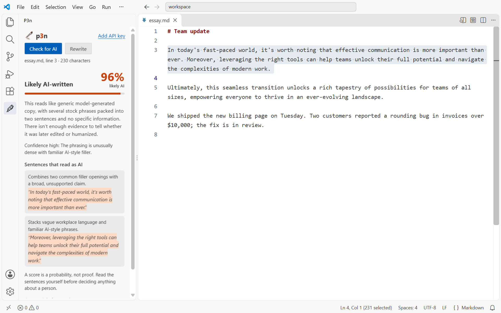
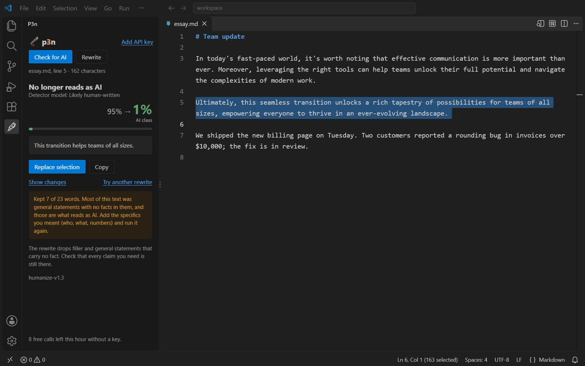
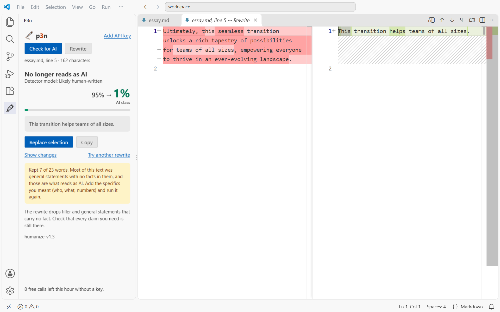

<p align="center">
  
</p>

<h1 align="center">p3n for VS Code</h1>

<p align="center">
  Select text in the editor. See if it reads as AI-written, or rewrite it in place.
</p>

<p align="center">
  <a href="https://marketplace.visualstudio.com/items?itemName=nikita-andreiev.p3n-vscode">VS Code Marketplace</a> · <a href="https://open-vsx.org/extension/nikita-andreiev/p3n-vscode">Open VSX</a> · <a href="https://p3n.si">p3n.si</a> · <a href="https://nikita-andreiev.com/p3n/">All p3n apps</a>
</p>

<p align="center">
  <a href="https://github.com/Barabosik/p3n-vscode/actions/workflows/ci.yml"></a>
  <a href="https://marketplace.visualstudio.com/items?itemName=nikita-andreiev.p3n-vscode"></a>
  <a href="https://open-vsx.org/extension/nikita-andreiev/p3n-vscode"></a>
</p>



## What it does

- **Check for AI.** A score, a one-line reason, and the sentences that give it away, highlighted in your text.
- **Rewrite.** A version that keeps your facts and drops the filler. **Show changes** opens it next to your selection in VS Code's diff editor, and **Replace selection** puts it where your selection was, as one undo step.
- Results open in the p3n view in the side bar, in your light or dark theme.
- Works on any text you can select: Markdown, plain text, docs, comments, commit messages.



## Use

1. Select text in an editor. Check needs at least 40 characters, and Rewrite a sentence of eight words.
2. Right-click it and choose **p3n: Check for AI** or **p3n: Rewrite**. Both are in the command palette (Ctrl+Shift+P, or Cmd+Shift+P on a Mac) too, and the p3n view has buttons for them. **Cancel** under the progress bar stops a run.
3. After a check, the sentences it lists are highlighted in your text. Hover one to see why. Editing the file, running p3n again or **Clear highlights** in the view removes them.
4. After a rewrite, **Show changes** opens your selection and the rewrite side by side in VS Code's diff editor. Nothing in your file changes until you click **Replace selection**; Ctrl+Z (Cmd+Z on a Mac) in the editor undoes it. **Copy** and **Try another rewrite** are next to it.



## Commands and shortcuts

| Command | ID | Where |
| --- | --- | --- |
| p3n: Check for AI | `p3n.check` | Right-click a selection, the command palette, the p3n view |
| p3n: Rewrite | `p3n.rewrite` | Right-click a selection, the command palette, the p3n view |
| p3n: Clear highlights | `p3n.clearHighlights` | The command palette while a check's highlights are shown, or **Clear highlights** in the p3n view |
| p3n: Set API key | `p3n.setKey` | The command palette, or **Add API key** at the top of the p3n view |
| p3n: Remove API key | `p3n.removeKey` | The command palette once a key is set, or **API key** at the top of the p3n view |
| p3n: Open p3n.si | `p3n.openSite` | The command palette, or **p3n.si ↗** at the bottom of the p3n view |

p3n sets no keyboard shortcuts, so it never takes keys you already use. To add your own, open **Keyboard Shortcuts** (Ctrl+K Ctrl+S, or Cmd+K Cmd+S on a Mac), search for **p3n**, double-click a command and press the keys. VS Code shows if they're already in use. Or add them to `keybindings.json`:

```jsonc
// The keys are an example: pick ones that are free on your keyboard.
[
  { "key": "ctrl+alt+shift+c", "command": "p3n.check", "when": "editorHasSelection" },
  { "key": "ctrl+alt+shift+r", "command": "p3n.rewrite", "when": "editorHasSelection" }
]
```

p3n has no settings. The API key isn't one: it's kept in secret storage, as below. The highlight colours are theme colours (`p3n.sentenceBackground`, `p3n.sentenceUnderline`, `p3n.hitBackground`, `p3n.hitUnderline`), so `workbench.colorCustomizations` can change them.

## Free, or with a key

You get 10 checks or rewrites an hour without an account, up to 5,000 characters each. For more, [sign up at p3n.si](https://p3n.si/register) (you get free credit), make a key on the [API keys](https://p3n.si/dashboard/keys) page, and run **p3n: Set API key** (or click **Add API key** in the p3n view). p3n checks the key before it saves it, so a typo never replaces a key that works. With a key, p3n takes up to 200,000 characters and bills your p3n balance.

The key is kept in VS Code's secret storage, encrypted with your system's keychain. It's never written to settings.json and isn't synced. **p3n: Remove API key** deletes it.

## Privacy

The extension sends the text you selected to `api.p3n.si`, and only when you run Check for AI or Rewrite. The extension keeps no history and has no telemetry. p3n.si keeps the text for up to 7 days. The details are in [PRIVACY.md](PRIVACY.md).

## Install

### From the VS Code Marketplace

Install [p3n from the Marketplace](https://marketplace.visualstudio.com/items?itemName=nikita-andreiev.p3n-vscode). You can also search for **p3n** in the Extensions view (Ctrl+Shift+X, or Cmd+Shift+X on a Mac) and click **Install**. From a terminal:

```bash
code --install-extension nikita-andreiev.p3n-vscode
```

Marketplace installs update themselves. You need VS Code 1.90 or later.

### From Open VSX

For VSCodium, Cursor and Windsurf: install [p3n from Open VSX](https://open-vsx.org/extension/nikita-andreiev/p3n-vscode), or search for **p3n** in their Extensions view. Open VSX installs update themselves.

### Install from VSIX

If you can't use either store, install the `.vsix` file from a release. It's the same package the stores have.

1. Download the `.vsix` file from the [latest release](https://github.com/Barabosik/p3n-vscode/releases/latest).
2. In VS Code, open the Extensions view (Ctrl+Shift+X, or Cmd+Shift+X on a Mac).
3. Click **…** at the top of the view, choose **Install from VSIX…** and pick the file.
4. The p3n pen appears in the activity bar. Select some text and right-click it to start.

From a terminal, `code --install-extension` with the file's path does the same. VSCodium, Cursor and Windsurf install a `.vsix` the same way.

An install from a `.vsix` doesn't update itself. To update, install the next release's file over it, or install p3n from a store instead.

### From source

Run `npm ci` and `npm run package`, then install the `p3n-vscode-<version>.vsix` it writes, as above.

## Known gaps

- With several cursors, p3n uses the main selection.
- Desktop VS Code only for now. vscode.dev and github.dev aren't supported yet.
- Rewrite is for prose. On code it treats everything as text, so check the result before you keep it.

## Other p3n apps

p3n also works in [Chrome and Firefox](https://nikita-andreiev.com/p3n/#browser), [Word and Excel](https://nikita-andreiev.com/p3n/#office), [Google Docs](https://nikita-andreiev.com/p3n/#docs), [Obsidian](https://nikita-andreiev.com/p3n/#obsidian) and [Sublime Text](https://nikita-andreiev.com/p3n/#sublime). Install steps for each are on [nikita-andreiev.com/p3n](https://nikita-andreiev.com/p3n/).

## Open source

MIT licence. Bugs and ideas go in [issues](https://github.com/Barabosik/p3n-vscode/issues). Tests and builds are in [CONTRIBUTING.md](CONTRIBUTING.md).
